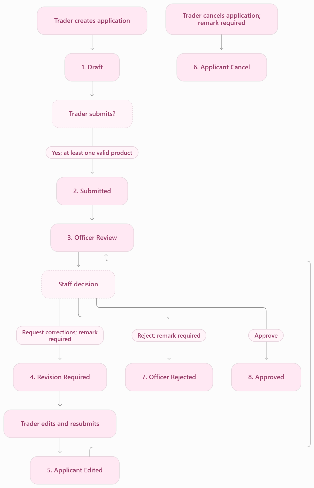
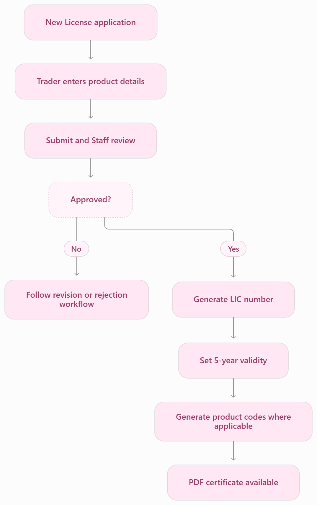
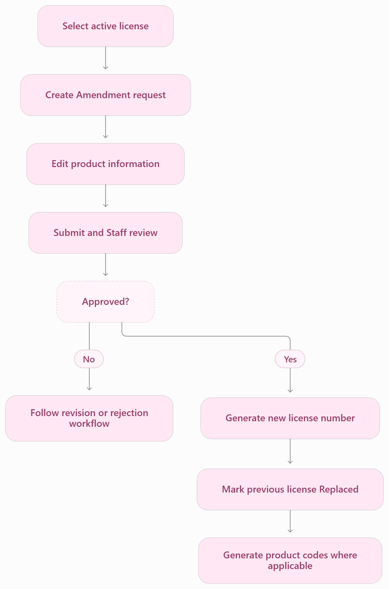
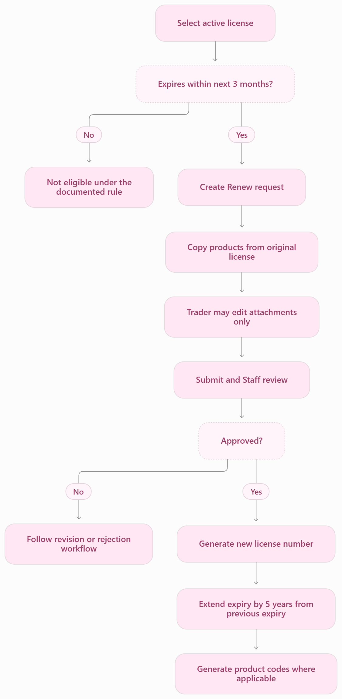
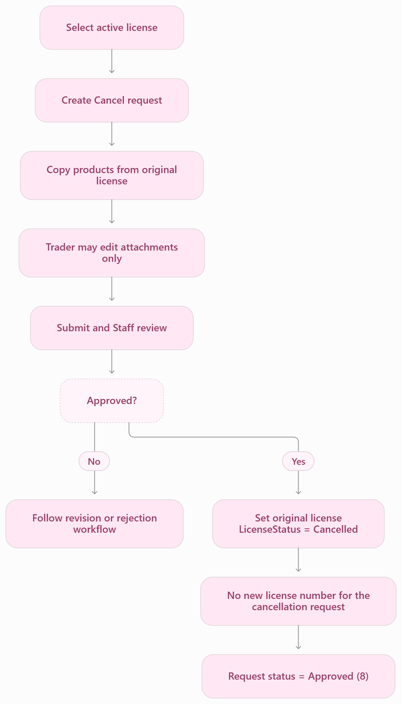

# Business Workflow

## 1. Document Purpose

This document describes the business processes supported by the **License Management System**, based on the supplied README and the current implementation it describes. It explains the user roles, application types, application status lifecycle, license lifecycle rules, document handling, and version history.

> **Project status:** Under active development. The workflow below reflects the README/source snapshot. Confirm the latest controller logic before using it as a formal operating procedure.

## 2. Actors and Responsibilities

| Actor | Responsibilities |
|---|---|
| **Trader** | Registers and signs in, creates an application draft, enters or reviews application information, uploads supporting documents, submits the application, responds to revision requests, and may cancel their own application. |
| **Staff** | Reviews submitted applications, moves them into officer review, requests corrections, rejects applications, or approves applications. |
| **System** | Generates application and license numbers, validates sessions and access rights, enforces application and license rules, records status history, stores version snapshots when applicable, and generates PDF certificates for approved applications. |

## 3. Application Types and Business Rules

| Type | Application | Creation / applicant input | Result when approved |
|---:|---|---|---|
| 1 | **New License** | Trader enters product information and supporting documents. | Generates a new license number and sets a 5-year validity period. |
| 2 | **Amendment** | References an active license. Product information can be edited. | Generates a new license number and marks the previous license `Replaced`. |
| 3 | **Renew** | References an eligible active license expiring within the next 3 months. Product information is copied from the original license; Trader can edit attachments only. | Generates a new license number and extends expiry by 5 years from the previous expiry date. |
| 4 | **Cancel** | References an active license. Product information is copied from the original license; Trader can edit attachments only. | Sets the original license's `LicenseStatus` to `Cancelled`. No new license number is generated for the cancellation request. |

### 3.1 Related Pending Request Rule

The API prevents a second pending Amendment, Renew, or Cancel request for the same license while an earlier related request is in statuses **1–5**.

### 3.2 Product Requirements

- An application must contain at least one valid product before it can be submitted.
- New License and Amendment accept product details from the applicant.
- Renew and Cancel copy product details from the referenced license; the applicant cannot edit those products through the application edit endpoint.
- Approved New License, Amendment, and Renew applications receive generated product codes where applicable.

## 4. Application Status Lifecycle

The application status IDs described in the README are:

| ID | Status | Actor / meaning |
|---:|---|---|
| 1 | **Draft** | Created by the system when the Trader creates an application. |
| 2 | **Submitted** | Trader submits the application. |
| 3 | **Officer Review** | Staff starts or continues review. |
| 4 | **Revision Required** | Staff requests corrections. A remark is required. |
| 5 | **Applicant Edited** | Trader submits an edited version after a revision request. |
| 6 | **Applicant Cancel** | Trader cancels the application. A remark is required. |
| 7 | **Officer Rejected** | Staff rejects the application. A remark is required. |
| 8 | **Approved** | Staff approves the request. |
| 9 | **License Cancel** | Status name is defined in the controller; the current approval code does not assign this status to an approved Cancel-type request. |

### 4.1 Main Status Flow

**Flow interpretation:** The diagram shows the primary path and the revision loop described in the README. It does not imply additional transitions or permissions beyond those documented there.

### 4.2 Important Cancellation Distinction

There are two different concepts:

1. **Applicant Cancel (status ID 6):** the Trader cancels an application request through `TraderCancel`. A remark is required.
2. **Cancel application type (type 4):** a request to cancel an existing license. When Staff approves this request, the request itself is saved as **Approved (status ID 8)**, while the original license's `LicenseStatus` is changed to `Cancelled`.

Status ID 9 (`License Cancel`) is defined in the status mapping, but the README states that the current approval code does not assign ID 9 to the Cancel-type request.

## 5. Trader Workflow

### 5.1 Register and Sign In

1. Trader registers an account. The server assigns the role `Trader`.
2. Trader signs in through the account API.
3. On successful login, the system creates a database-backed session token.
4. The frontend sends the token in the `X-Session-Token` header for protected application requests.

### 5.2 Create an Application

1. Trader selects one of the supported application types: New License, Amendment, Renew, or Cancel.
2. For Amendment, Renew, or Cancel, the application references an active license. Renew must meet the eligibility rule: the active license is expiring within the next 3 months.
3. Trader enters the application information allowed for that type.
4. The system creates the application as **Draft (status 1)** and generates its application number.
5. Trader may add supporting documents under the file-upload rules.

### 5.3 Edit an Application

- Editing a Draft does not create a version snapshot.
- When a Trader edits an application in a non-draft editable status, the current application data, products, and file metadata are copied into the version tables.
- After the snapshot is saved, `VersionNo` is incremented and the application status becomes **Applicant Edited (status 5)**.
- Renew and Cancel product information is copied from the referenced license and cannot be edited through the application edit endpoint; the Trader can edit attachments only.

The README does not enumerate the complete set of statuses in which the edit endpoint is enabled. Refer to the current API implementation for that exact allow-list.

### 5.4 Upload and Manage Documents

| Rule | Current behavior |
|---|---|
| Accepted file types | PDF, JPG, JPEG, PNG |
| Maximum size | 10 MB per file |
| Maximum files | 10 files per upload request |
| Upload allowed in | Draft, Revision Required, Applicant Edited |
| File deletion allowed in | Draft only |

The system stores uploaded files under `wwwroot/uploads` and records their metadata in SQL Server. Downloads through the API check the session and application access.

### 5.5 Submit or Resubmit

1. Trader submits a Draft or resubmits after making corrections.
2. The application must contain at least one valid product before submission.
3. The application moves to **Submitted (status 2)**.
4. The application becomes available for Staff review. Staff list access is limited to applications where `Datesubmission` is not null.

### 5.6 Cancel an Application Request

Trader can cancel an application through `POST /api/applications/TraderCancel/{trid}`. A remark is required, and the request is recorded as **Applicant Cancel (status 6)**.

## 6. Staff Workflow

1. Staff signs in and accesses submitted applications.
2. Staff opens an application and reviews its details, products, documents, and status history.
3. The application enters or continues **Officer Review (status 3)**.
4. Staff chooses an outcome supported by the workflow:
   - **Request revision:** set status to Revision Required (4) and provide a remark.
   - **Reject:** set status to Officer Rejected (7) and provide a remark.
   - **Approve:** set status to Approved (8).
5. On approval, the system applies the business rules for the relevant application type, including license number generation or license status changes where applicable.
6. For an approved application, a PDF certificate can be generated through the certificate endpoint.

The README states that application creation and Staff approval use serializable database transactions.

## 7. License Lifecycle Rules

### 7.1 New License

### 7.2 Amendment

### 7.3 Renew

### 7.4 Cancel Existing License

## 8. Application Number and License Number

The API generates numbers on the server and stores counters in `RunningNumbers`.

| Number | Format | Example |
|---|---|---|
| Application number (`TRID`) | `TRyyyyMMddNNNN` | `TR202611220001` |
| License number | `LICyyyyMMddNNNN` | `LIC202611220001` |

`RunningNumbers.Prefix` is unique in the supplied DDL. The exact concurrency behavior for reading and updating `LastNumber` depends on the current API implementation.

## 9. Version History and Audit Trail

### 9.1 Version Snapshot Behavior

- Draft edits do not create snapshots.
- For edits in a non-draft editable status, the current application details, product rows, and file metadata are copied to the version tables.
- The application version is then incremented and the status becomes Applicant Edited (5).
- Historical file metadata retains the stored file path and can be retrieved through the version-file download endpoint.

### 9.2 Status History

`ApplicationStatusHistory` stores status transition information, including status ID/name, update date, updating user information, and remark. Remarks are required for revision requests, Staff rejection, and Trader cancellation as described in the README.

## 10. Workflow-Related API Endpoints

All application endpoints use the `/api/applications` prefix. Protected endpoints require the `X-Session-Token` header.

| Operation | Endpoint |
|---|---|
| Create Draft | `POST /` |
| Get eligible licenses | `GET /EligibleLicenses?type={type}` |
| Upload documents | `POST /upload/{trid}` |
| Delete a Draft attachment | `DELETE /file/{trid}/{fileId}` |
| Edit application | `PUT /TraderEdit/{trid}` |
| View version history | `GET /VersionHistory/{trid}` |
| View a version | `GET /VersionDetail/{trid}/{version}` |
| Submit / resubmit | `POST /Submitted/{trid}` |
| Trader cancels application | `POST /TraderCancel/{trid}` |
| Staff updates status | `PUT /UpdateStatus/{trid}` |
| Generate approved certificate | `GET /Certificate/{trid}` |

## 11. Rules and Limitations to Keep in Mind

- Staff application lists include only submitted applications (`Datesubmission` is not null).
- Trader ownership is resolved from the signed-in database account, not from identity values supplied by the frontend.
- A valid product is required before submission.
- Revision requests and Staff rejection require a remark; Trader cancellation also requires a remark.
- Only Draft applications allow file deletion.
- Uploads are allowed only in Draft, Revision Required, and Applicant Edited statuses.
- Renew and Cancel copy product information from the referenced license; product editing through the application edit endpoint is not available for those types.
- Approval of a Cancel-type request changes the original license status to `Cancelled`; it does not set the request to status 9 in the current implementation described by the README.
- The README does not provide a complete transition matrix or the full edit-status allow-list. Do not infer unlisted transitions; verify them against the current controller code.

## 12. Related Documentation

- `README.md` — project overview, installation, technology stack, features, and API overview.
- `System_Architecture.md` — system layers, authentication, data storage, and database architecture.

