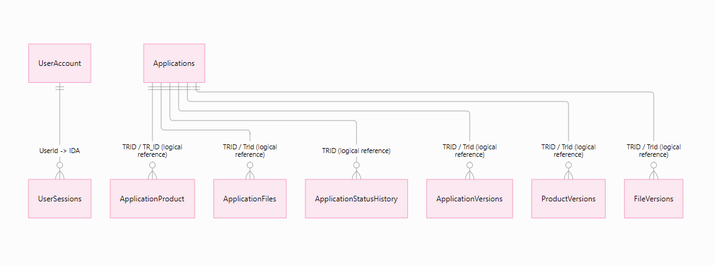

# Database Design

## 1. Purpose and Scope

This document describes the SQL Server database structure documented for the **License Management System**. The system uses Entity Framework Core through `LicenseManagementContext`.

> **Source and implementation note:** This document follows the supplied `README_updated.md` and its database summary. It is not a replacement for the complete SQL DDL or the current EF Core model configuration. Column data types, nullability, all constraints, and some relationship details are not fully specified in that source and are therefore not inferred here.

## 2. Database Overview

- Database name referenced by the project: `LicenseManagementDB`
- DBMS: Microsoft SQL Server
- Data access: Entity Framework Core
- Main areas: user accounts and sessions, applications, products, uploaded-file metadata, status history, version snapshots, and running numbers.

## 3. Entity Overview



**Relationship qualification:** Only the `UserSessions.UserId` to `UserAccount.IDA` foreign key is explicitly documented as a database foreign key. The application-related links shown above represent logical references by application number (`TRID`/`TrId`); the supplied DDL summary does not define foreign-key constraints for them.

## 4. Table Design

### 4.1 `Applications`

Stores application and license-related information.

| Column | Purpose / notes |
|---|---|
| `IDA` | Identity primary key |
| `TRID` | Application reference number |
| Applicant/company details | Applicant and establishment information; exact full column list is not reproduced in the README summary |
| `TYPE` | Application type: New License, Amendment, Renew, or Cancel |
| `STATUSID` | Numeric workflow status |
| `STATUSNAME` | Workflow status name |
| `LICENSENUMBER` | License number, where applicable |
| `DATESUBMISSION` | Submission date/time |
| `DATEAPPV` | Approval date/time |
| `DATEEXP` | License expiry date |
| `VersionNo` | Application version; default documented as `1` |
| `ReferenceLicenseNumber` | Existing license referenced by Amendment, Renew, or Cancel |
| `LicenseStatus` | State of the resulting/original license, e.g. `Cancelled` or `Replaced` |
| `LicenseStatusDate` | Date associated with license status |
| `ReplacedBy` | Reference to the replacement license, where applicable |

### 4.2 `ApplicationProduct`

Stores product information associated with an application.

| Column | Purpose / notes |
|---|---|
| `IDA` | Identity primary key |
| `TR_ID` | Logical application reference |
| `NEWCODE` | Generated product code, where applicable |
| `PRODUCTNAME` | Product name |
| `MODELNAME` | Product model |
| `DESCRIPTION` | Product description |
| `STATUSPRODUCT` | Product status field |
| `ACTIVE` | Active flag/field |

### 4.3 `ApplicationFiles`

Stores metadata for files attached to an application. The file itself is stored under `wwwroot/uploads` in the current implementation described by the README.

| Column | Purpose / notes |
|---|---|
| `Id` | Identity primary key |
| `TrId` | Logical application reference |
| `FileName` | Original/display file name |
| `FilePath` | Stored file path |
| `CreatedDate` | Creation timestamp; default documented as `GETDATE()` |

### 4.4 `ApplicationStatusHistory`

Stores status-change history for an application.

| Column | Purpose / notes |
|---|---|
| `IDA` | Identity primary key |
| `TRID` | Logical application reference |
| `STATUSID` | Status identifier |
| `STATUSNAME` | Status name |
| `DATEUPDATE` | Date/time of update |
| `NAMEUPDATE` | Name of the person making the update |
| `CITIZENID` | Citizen identifier recorded for the update |
| `Remark` | Remark associated with the status change |

### 4.5 `ApplicationVersions`

Stores application-level snapshots when a non-Draft application is edited.

| Column | Purpose / notes |
|---|---|
| `Id` | Identity primary key |
| `TrId` | Logical application reference |
| `VersionNo` | Snapshot version number |
| `Email` | Email value captured in the snapshot |
| `Tel` | Telephone value captured in the snapshot |
| `Remark` | Remark captured with the version |
| `CreateDate` | Snapshot creation timestamp; default documented as `GETDATE()` |
| `CreateBy` | User who created the snapshot |

### 4.6 `ProductVersions`

Stores product details captured in an application version.

| Column | Purpose / notes |
|---|---|
| `Id` | Identity primary key |
| `TrId` | Logical application reference |
| `VersionNo` | Related snapshot version |
| `ProductName` | Product name snapshot |
| `ModelName` | Model snapshot |
| `Description` | Description snapshot |

### 4.7 `FileVersions`

Stores file metadata associated with a historical application version.

| Column | Purpose / notes |
|---|---|
| `Id` | Identity primary key |
| `TrId` | Logical application reference |
| `VersionNo` | Related snapshot version |
| `FileName` | File name snapshot |
| `FilePath` | Stored path retained for historical retrieval |
| `CreateDate` | Snapshot timestamp; default documented as `GETDATE()` |

### 4.8 `UserAccount`

Stores user account and applicant identity/contact information. The table name is singular: `dbo.UserAccount`.

| Column | Purpose / notes |
|---|---|
| `IDA` | Identity primary key |
| `USERNAME` | Login username |
| `PASSWORD` | Password value; application uses ASP.NET Core `PasswordHasher<UserAccount>` |
| `CITIZENID` | Citizen identifier |
| `IDENTIFY` | Identity/reference field used by the application |
| `FULLNAME` | Full name |
| `USERTYPE` | Role, such as `Trader` or `Staff` |
| `CREATEDATE` | Account creation date |
| `COMPANYNAME` | Company name |
| `TEL` | Telephone |
| `EMAIL` | Email |

### 4.9 `UserSessions`

Stores database-backed login sessions.

| Column | Purpose / notes |
|---|---|
| `Id` | Identity primary key |
| `UserId` | Foreign key to `UserAccount.IDA` |
| `SessionToken` | Random session token; unique index documented |
| `ExpireDate` | Session expiration date/time |

### 4.10 `RunningNumbers`

Stores counters used to generate application and license numbers.

| Column | Purpose / notes |
|---|---|
| `ID` | Identity primary key |
| `Prefix` | Number prefix; unique constraint documented |
| `LastNumber` | Last counter value |
| `Dategen` | Date associated with number generation |
| `Typenumber` | Number type/category field |

## 5. Keys, Indexes, and Constraints

The supplied README/database summary explicitly documents the following:

- `UserAccount.IDA` is the account table's identity primary key.
- `UserSessions.Id` is an identity primary key.
- `UserSessions.UserId` references `dbo.UserAccount(IDA)`.
- `UserSessions.SessionToken` has a unique index.
- `UserSessions.UserId` has a non-unique index.
- `RunningNumbers.Prefix` has a unique constraint.
- `Applications.VersionNo` defaults to `1`.
- `ApplicationFiles.CreatedDate`, `ApplicationVersions.CreateDate`, and `FileVersions.CreateDate` default to `GETDATE()`.
- The supplied DDL summary does not document a unique constraint/index on `Applications.TRID`.
- The supplied DDL summary does not document foreign keys from `ApplicationProduct`, `ApplicationFiles`, `ApplicationStatusHistory`, `ApplicationVersions`, `ProductVersions`, or `FileVersions` to `Applications`.

### User session foreign key

The documented table and key names are singular and use `IDA`:

```sql
CONSTRAINT FK_UserSessions_UserAccount
    FOREIGN KEY (UserId) REFERENCES dbo.UserAccount (IDA)
```

Do not reference `dbo.UserAccounts`; that is not the table name documented for this project.

## 6. Application and License Numbering

Numbers are generated by the API and counters are stored in `RunningNumbers`.

| Number | Format | Example |
|---|---|---|
| Application number (`TRID`) | `TRyyyyMMddNNNN` | `TR202611220001` |
| License number | `LICyyyyMMddNNNN` | `LIC202611220001` |

The `RunningNumbers.Prefix` uniqueness constraint is documented. The precise concurrency/locking implementation for reading and updating `LastNumber` should be verified in the current source code.

## 7. Versioning Rules

- A new application starts with `VersionNo = 1` through the documented column default.
- Editing a Draft does not create a version snapshot.
- When a Trader edits an application in a non-Draft editable status, the current application data, products, and file metadata are copied to the version tables.
- After the snapshot is saved, the application version is incremented and its status becomes `Applicant Edited`.
- Historical file metadata retains the stored file path for retrieval through the version-file download endpoint.

## 8. Related Business Rules

- A request must contain at least one valid product before submission.
- New License and Amendment accept product details from the applicant.
- Renew and Cancel copy product details from the referenced license; the applicant cannot edit those products through the application edit endpoint.
- A second pending Amendment, Renew, or Cancel request for the same license is prevented while an earlier related request is in statuses 1–5.
- Approved New License, Amendment, and Renew applications receive generated product codes where applicable.

## 9. File Storage and Data Considerations

- File metadata is stored in SQL Server; uploaded file content is stored under `wwwroot/uploads` in the current implementation.
- The README notes that uploads are written to disk before metadata is saved. A failure can leave an unreferenced file; cleanup and transaction coordination are potential improvements.
- For production, review whether files can be served directly as public static content. The README recommends considering storage outside the web root and retaining authenticated download access.
- Do not commit real personal data, credentials, or confidential uploaded documents.

## 10. Items to Verify Against the Current Database

Before using this document as a physical database specification, compare it with the current SQL Server DDL and EF Core model configuration for:

1. Full column lists and exact SQL data types.
2. Nullability, lengths, defaults, and check constraints.
3. All primary keys, foreign keys, indexes, and cascade behaviors.
4. Whether `Applications.TRID` is unique in the actual database.
5. Whether additional relationships have been added since the README snapshot.

---

**Project:** License Management System  
**Database:** SQL Server (`LicenseManagementDB`)  
**Status:** Under active development
