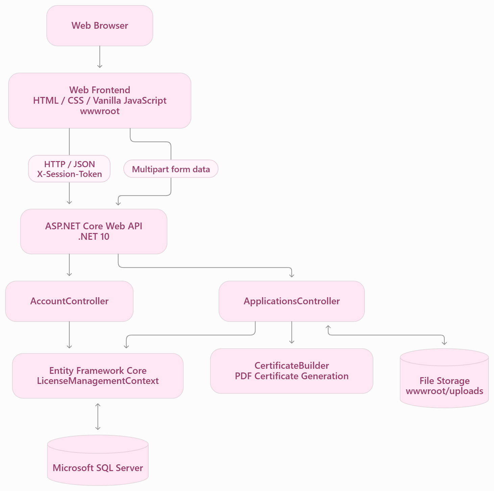

# System Architecture

## 1. Document Purpose

This document describes the architecture of the **License Management System** based on the supplied project README and its stated current implementation. It covers the application layers, request flow, authentication and authorization, data storage, and the main database entities.

> **Project status:** Under active development. This document reflects the implementation described in the current README/source snapshot. Confirm details against the latest local source and database scripts before treating this document as a deployment specification.

## 2. System Overview

The License Management System is a web-based application for managing medical-device establishment license requests. It supports two user roles:

- **Trader** — applicant who registers, creates and submits applications, provides supporting documents, and responds to revision requests.
- **Staff** — officer who reviews submitted applications, requests corrections, rejects requests, or approves them.

The frontend is served by the ASP.NET Core API project from `wwwroot`. Browser-side JavaScript communicates with the API using HTTP requests and JSON. Entity Framework Core provides database access to Microsoft SQL Server. Uploaded documents are stored in `wwwroot/uploads`, while file metadata is stored in SQL Server.

## 3. Technology Stack

| Layer / Concern | Technology |
|---|---|
| Language | C# |
| Backend | ASP.NET Core Web API (.NET 10) |
| ORM | Entity Framework Core |
| Database | Microsoft SQL Server |
| Frontend | HTML5, CSS3, vanilla JavaScript |
| API communication | HTTP endpoints with JSON; multipart form data for file uploads |
| Authentication | Database-backed session token |
| Password hashing | ASP.NET Core `PasswordHasher<UserAccount>` |
| PDF generation | `CertificateBuilder` |
| Development tools | Visual Studio, SQL Server Management Studio, Git / GitHub |

## 4. High-Level Architecture

### 4.1 Frontend Layer

- HTML pages, CSS, JavaScript, and partials are served from `LicenseManagement.Api/wwwroot`.
- JavaScript calls the API for account and application operations.
- Protected application requests include the `X-Session-Token` header.
- File uploads use multipart form data.

### 4.2 API Layer

The README identifies two main controllers:

- `AccountController` — account registration, login, logout, user lookup, password change, and session validation.
- `ApplicationsController` — application listing and detail, application creation and editing, document handling, status transitions, version history, license lookup, and certificate generation.

The API is responsible for validating the session, determining the current user and role, checking record ownership, validating workflow rules, and coordinating persistence.

### 4.3 Data Access Layer

Entity Framework Core uses `LicenseManagementContext` to access SQL Server. The README lists model classes for applications, products, files, status history, version snapshots, running numbers, accounts, and sessions.

### 4.4 File Storage

Uploaded PDF and image files are stored under `wwwroot/uploads`. Their metadata, including the stored path, is held in SQL Server. The API provides file-list and download endpoints that perform session and application-access checks.

**Security consideration:** Because the current storage path is under the web root, review whether files could also be served as public static content. The README recommends considering storage outside the web root for production while retaining authenticated download access.

### 4.5 PDF Generation

`CertificateBuilder` is used to generate a PDF certificate for an approved application. The certificate endpoint is `GET /api/applications/Certificate/{trid}`.

## 5. Authentication and Authorization Architecture

### 5.1 Login and Session Creation

1. A user registers or signs in through `AccountController`.
2. On successful login, the API generates a cryptographically secure random session token.
3. The API stores the token, user ID, and expiry time in `UserSessions`.
4. The session expires 8 hours after login.
5. The login flow removes expired sessions belonging to the user who is signing in.

### 5.2 Authenticated API Request

1. The frontend sends the token in the `X-Session-Token` request header.
2. The API looks up the token in `UserSessions`.
3. The API checks that the session exists and has not expired.
4. The API loads the associated account from `UserAccount`.
5. The API checks the user's role and whether the requested record is accessible to that user.

The role displayed in the frontend is for presentation only. The API uses the user record associated with the database session to determine permissions.

### 5.3 Role and Data Access

- A Trader can access their own applications. Ownership is determined from the signed-in user's database record, not applicant identity values supplied by the frontend.
- Staff access to application lists is limited to submitted applications, identified by `Datesubmission` not being null.
- The API performs role and ownership checks on the server.

### 5.4 Logout and Password Change

- Logout removes the current session.
- Changing a password invalidates all sessions belonging to that account.
- Passwords are hashed with ASP.NET Core `PasswordHasher<UserAccount>`.
- A legacy plain-text password is upgraded to a hash after a successful login.

## 6. Application Domain Architecture

The system supports four application types:

| Type | Application | Main behavior |
|---:|---|---|
| 1 | New License | Trader enters product information. Approval generates a license number and a 5-year validity period. |
| 2 | Amendment | References an active license. Product information can be edited. Approval generates a new license number and marks the previous license `Replaced`. |
| 3 | Renew | References an eligible active license expiring within the next 3 months. Products are copied from the original license; the Trader can edit attachments only. Approval generates a new license number and extends expiry by 5 years from the previous expiry date. |
| 4 | Cancel | References an active license. Products are copied from the original license; the Trader can edit attachments only. Approval sets the original license's `LicenseStatus` to `Cancelled`; no new license number is generated for the cancellation request. |

The API prevents a second pending Amendment, Renew, or Cancel request for the same license while an earlier related request is in statuses 1–5.

## 7. Database Architecture

The following tables are identified in the README. The names and key columns follow the supplied SQL Server DDL described there.

| Table | Purpose / important columns |
|---|---|
| `Applications` | Main application and license-related record; includes `IDA`, `TRID`, applicant/company details, `TYPE`, `STATUSID`, `STATUSNAME`, `LICENSENUMBER`, submission/approval/expiry dates, `VersionNo`, `ReferenceLicenseNumber`, `LicenseStatus`, `LicenseStatusDate`, and `ReplacedBy`. |
| `ApplicationProduct` | Product rows associated logically with an application through `TR_ID`; includes product name, model, description, product code, and active/status fields. |
| `ApplicationFiles` | Current application file metadata, including `TrId`, `FileName`, `FilePath`, and `CreatedDate`. |
| `ApplicationStatusHistory` | Status transition history, including status, update date/user, citizen ID, and remark. |
| `ApplicationVersions` | Historical application-level snapshot information, including `TrId`, `VersionNo`, contact details, remark, creation date, and creator. |
| `ProductVersions` | Product data snapshots by application and version. |
| `FileVersions` | Historical file metadata by application and version. |
| `RunningNumbers` | Number-generation counters; `Prefix` is unique and `LastNumber` stores the counter. |
| `UserAccount` | User account and applicant details; primary key `IDA`. The table name is singular. |
| `UserSessions` | Session token, associated `UserId`, and expiry date. |

### 7.1 Relationships and DDL Notes

- `UserSessions.UserId` has a foreign key to `UserAccount.IDA`.
- `UserSessions.SessionToken` has a unique index; `UserSessions.UserId` has a non-unique index.
- `RunningNumbers.Prefix` has a unique constraint.
- In the supplied DDL, `ApplicationProduct`, `ApplicationFiles`, `ApplicationStatusHistory`, `ApplicationVersions`, `ProductVersions`, and `FileVersions` use `TRID` / `TrId` as logical application references; the supplied DDL does not define foreign-key constraints from these tables to `Applications`.
- The supplied DDL does not define a unique constraint or index on `Applications.TRID`.
- The account table is `dbo.UserAccount` (singular), not `dbo.UserAccounts`.

Confirm the actual constraints in the current database before making schema or migration changes.

### 7.2 Application Versioning

- New applications start with `VersionNo = 1` through the database column default.
- Editing a Draft does not create a version snapshot.
- When a Trader edits an application in a non-draft editable status, the current application data, products, and file metadata are copied to the version tables.
- After the snapshot is saved, the application version is incremented and its status becomes `Applicant Edited`.
- Historical file metadata retains the stored file path so that files from earlier versions can be retrieved through the version-file download endpoint.

### 7.3 Number Generation

Numbers are generated by the API and counters are stored in `RunningNumbers`.

| Number | Format | Example |
|---|---|---|
| Application number (`TRID`) | `TRyyyyMMddNNNN` | `TR202611220001` |
| License number | `LICyyyyMMddNNNN` | `LIC202611220001` |

The supplied DDL enforces uniqueness on `RunningNumbers.Prefix`. The README notes that safe concurrent reads and updates of `LastNumber` depend on the implementation in the API code.

## 8. Main API Areas

All account routes use `/api/account`:

- `POST /register`
- `POST /login`
- `POST /logout`
- `GET /GetUserId?id={id}`
- `PUT /ChangePasswordByUsername`
- `GET /session`

All application routes use `/api/applications`. Protected endpoints require `X-Session-Token`. Main endpoint groups include:

- **Listing and search:** `GET /GetApplications`, `GET /GetApplicationStats`, `GET /GetDataAll`, `GET /Search?keyword={keyword}`
- **Application and license details:** `GET /Detail/{trid}`, `GET /LicenseDetail/{licenseNumber}`, `GET /EligibleLicenses?type={type}`
- **Create and edit:** `POST /`, `PUT /TraderEdit/{trid}`, `POST /Submitted/{trid}`, `POST /TraderCancel/{trid}`
- **Documents:** `POST /upload/{trid}`, `DELETE /file/{trid}/{fileId}`, `GET /files/{trid}`, `GET /file-download/{fileId}`
- **Version history:** `GET /VersionHistory/{trid}`, `GET /VersionDetail/{trid}/{version}`, `GET /version-file-download/{trid}/{version}/{fileName}`
- **Staff processing and certificate:** `PUT /UpdateStatus/{trid}`, `GET /Certificate/{trid}`

See `README.md` for the endpoint descriptions and access notes.

## 9. Operational and Security Considerations

The README identifies the following current limitations and considerations:

- Use HTTPS and do not expose session tokens in logs or URLs.
- Review session revocation, token storage on the frontend, and expired-session cleanup. A separate scheduled cleanup process is not documented.
- `ChangePasswordByUsername` is callable without an existing session and validates the username and old password in the request; rate limiting and additional abuse protections should be considered.
- Review whether files under `wwwroot/uploads` can be served directly as public static content; consider moving them outside the web root for production.
- File upload writes files to disk before saving metadata to the database. A failure can leave an unreferenced file.
- Application creation and staff approval use serializable database transactions. Other multi-step operations, including file upload and some status/history updates, are not all wrapped in a single transaction.
- Continue reviewing input validation and error handling as the application evolves.
- An automated unit/integration test project is not represented in the supplied project structure.
- Do not commit real passwords, connection credentials, personal data, or confidential uploaded documents. Keep `wwwroot/uploads/` excluded from source control.

## 10. Related Documentation

- `README.md` — project overview, setup, technology stack, features, and API overview.
- `Business_Workflow.md` — business process and application status flows.

