# User Manual

## 1. Introduction

The **License Management System** is a web-based application for managing medical-device establishment license requests. It supports two user roles:

- **Applicant** — registers an account, creates and submits applications, uploads supporting documents, and responds to requests for revision.
- **Staff** — reviews submitted applications, requests corrections, rejects applications, or approves applications.

> **Project status:** Under active development. This manual describes the functions and rules documented in the supplied project README. Screen labels and page layouts may change as development continues.

## 2. Getting Started

### 2.1 Open the application
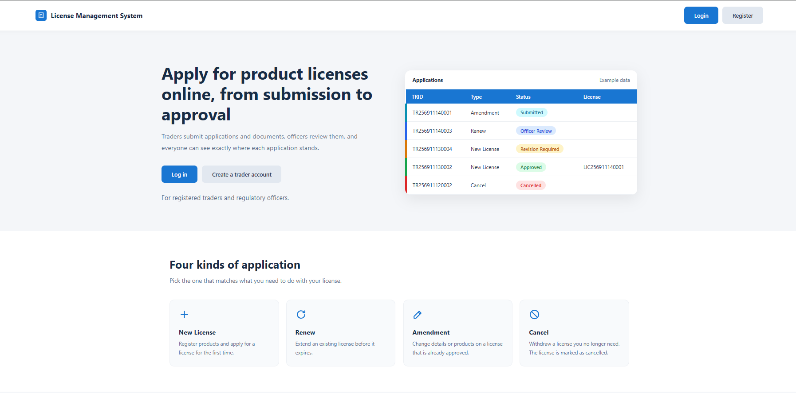

1. Start the API project using the configured development environment.
2. Open the local URL displayed by the application or configured in Visual Studio.
3. The frontend pages are served from the API project's `wwwroot` directory.

### 2.2 Register as a Applicant
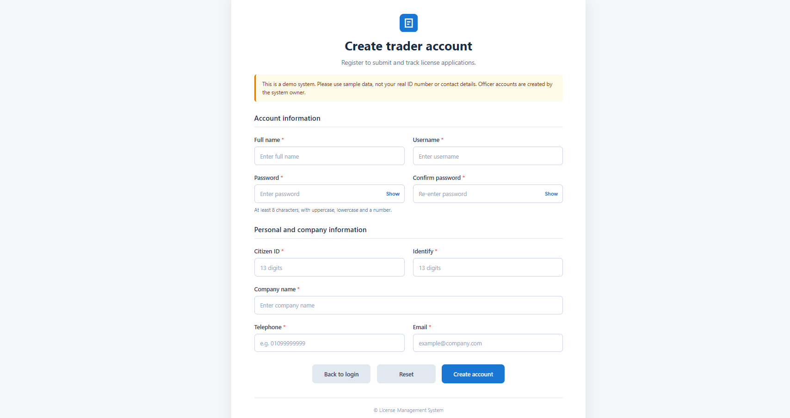

1. Open the registration page.
2. Enter the account and applicant information requested by the form.
3. Submit the registration form.
4. The server assigns the new account the `Applicant` role.

The README documents public registration for Applicant accounts. It does not describe a self-service Staff registration process.

### 2.3 Log in
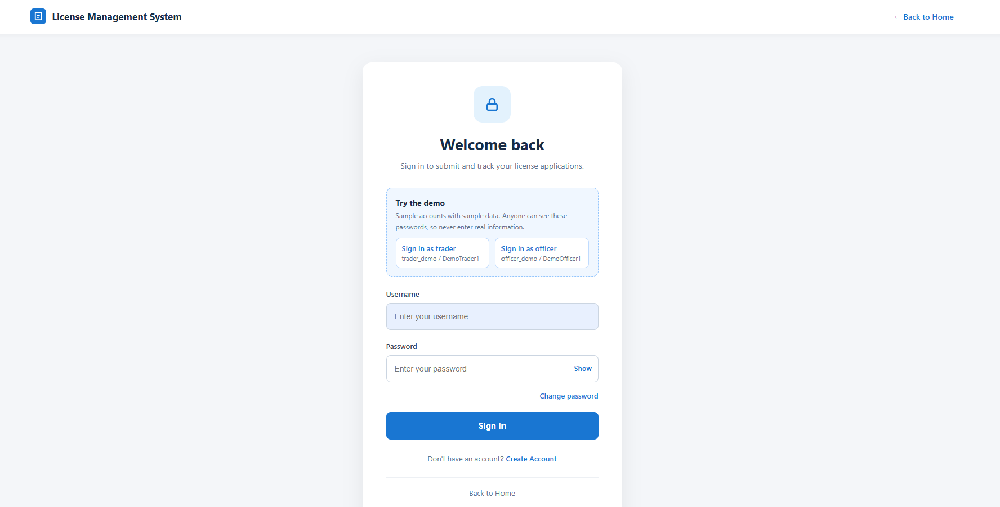

1. Open the login page.
2. Enter the username and password.
3. Submit the login form.
4. After successful login, the API creates a session and returns a session token and basic user details.
5. The frontend includes the token in the `X-Session-Token` header when calling protected application endpoints.

A session expires 8 hours after login. The API validates the session and determines the user's role from the associated database account.

### 2.4 Log out
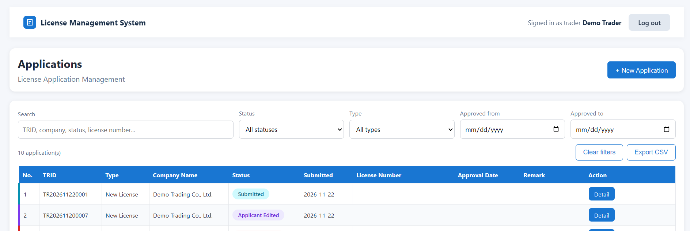

Use the application's logout function. The API removes the current session.

### 2.5 Change password
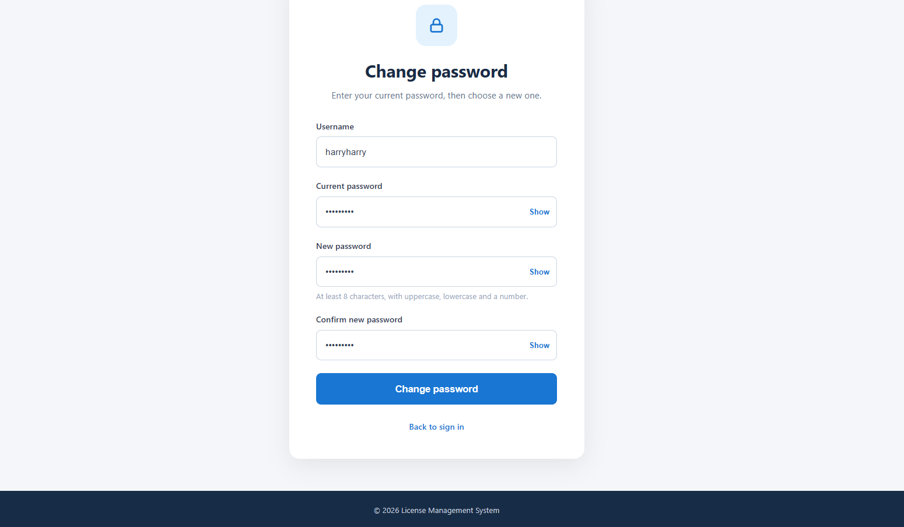
Use the password-change function and provide the username, current password, and new password as required by the endpoint. The documented password rule requires at least 8 characters, including uppercase, lowercase, and a number. A successful password change invalidates all sessions for that account.

The demo usernames `Applicant_demo` and `officer_demo` cannot change their passwords through the documented password-change endpoint.

## 3. Applicant/Trader User Guide

### 3.1 View applications
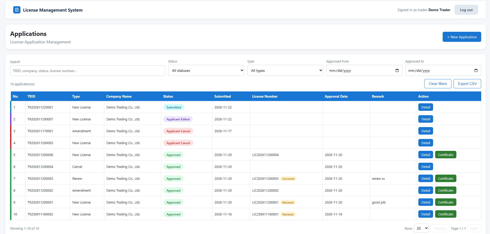
1. Log in as a Applicant.
2. Open the application list.
3. Review the applications associated with your account.
4. Use the available search and list filters where provided.
5. Open an application to view its details, products, status history, and attached-file metadata.

The API determines ownership from the signed-in user's database record. Applicant identity values supplied by the browser are not the source of ownership authorization.

### 3.2 Create a new application
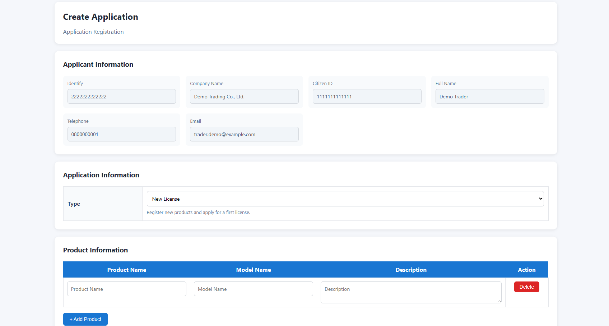

1. Open the application creation page.
2. Select one of the supported application types:
   - **New License**
   - **Amendment**
   - **Renew**
   - **Cancel**
3. Enter the requested application information.
4. For Amendment, Renew, or Cancel, select/reference the applicable existing license where required.
5. Save the application. The system creates it in `Draft` status.
6. Add supporting documents if needed.
7. Check the application information before submitting.

The API generates the application number (`TRID`) on the server. The documented format is `TRyyyyMMddNNNN`.

### 3.3 Understand application types
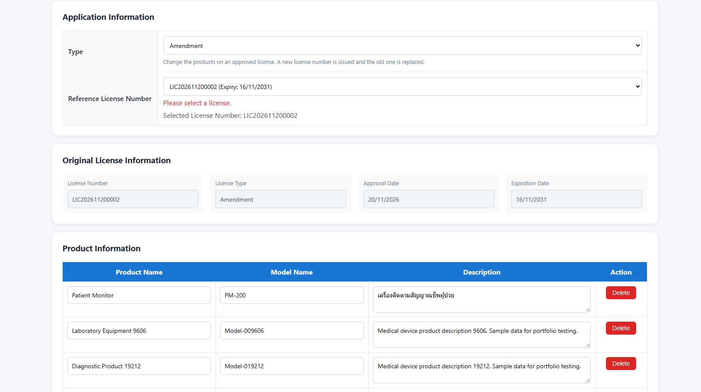

| Type | When to use / system behavior |
|---|---|
| New License | Submit a new license request. The applicant enters product information. Approval generates a license number and a 5-year validity period. |
| Amendment | Request a change to an existing active license. Product information can be edited. Approval generates a new license number and marks the previous license `Replaced`. |
| Renew | Renew an eligible active license that expires within the next 3 months. Products are copied from the original license; the applicant can edit attachments only. Approval generates a new license number and extends expiry by 5 years from the previous expiry date. |
| Cancel | Request cancellation of an active license. Products are copied from the original license; the applicant can edit attachments only. Approval changes the original license's `LicenseStatus` to `Cancelled`; no new license number is generated for the cancellation request. |

The system prevents a second pending Amendment, Renew, or Cancel request for the same license while an earlier related request is in statuses 1–5.

### 3.4 Add supporting documents
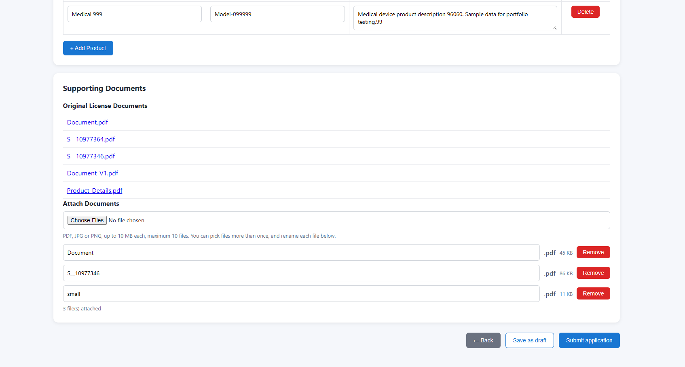

1. Open the relevant application.
2. Upload the required supporting file(s) using the file upload function.
3. Confirm that the files appear in the application's file list.

Documented upload rules:

- Accepted file types: PDF, JPG, JPEG, and PNG.
- Maximum file size: 10 MB per file.
- Maximum files per upload request: 10.
- Upload is allowed while the application is in `Draft`, `Revision Required`, or `Applicant Edited` status.
- File deletion is allowed only while the application is in `Draft` status.

### 3.5 Submit an application
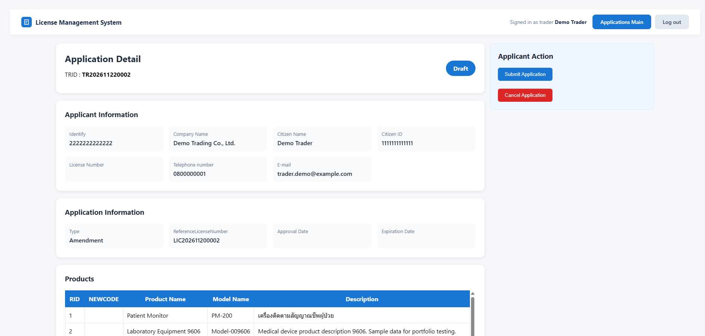

1. Open the Draft application.
2. Review applicant details and product information.
3. Confirm that the request contains at least one valid product.
4. Confirm that the required supporting documents have been attached.
5. Use the Submit action.
6. The application moves to `Submitted` status.

After submission, the application becomes available for Staff review. Staff list access is limited to applications with a non-null `Datesubmission` value.

### 3.6 Respond to a revision request
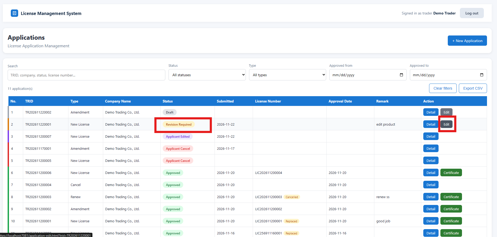

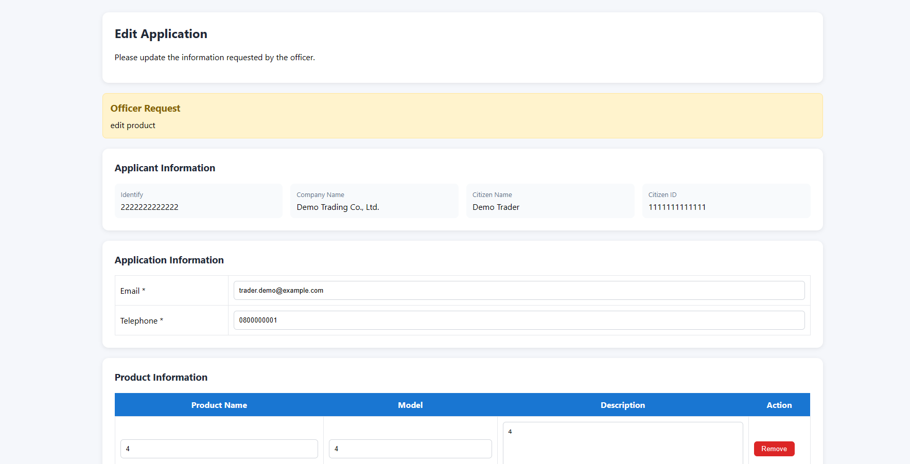

1. Open the application with `Revision Required` status.
2. Read the Staff remark to understand the requested corrections.
3. Edit the permitted application information and/or upload supporting documents.
4. Save the changes.
5. The system captures a snapshot of the previous non-Draft application data, products, and file metadata.
6. The version number is incremented and the application status becomes `Applicant Edited`.
7. Submit/resubmit the edited application for further review.

The README does not enumerate every field editable in each status. The API's current validation rules determine which fields can be changed.

### 3.7 Cancel your application
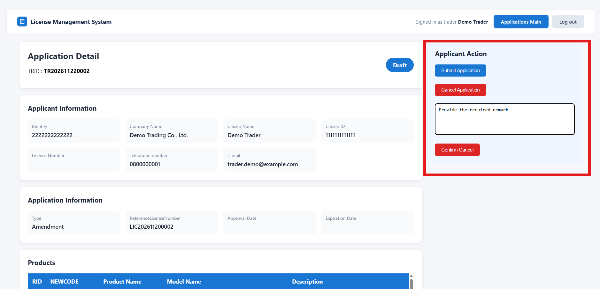

1. Open the application you want to cancel.
2. Use the Applicant cancellation action.
3. Provide the required remark.
4. Submit the cancellation request.

The application status becomes `Applicant Cancel` (status ID 6). This is different from choosing the **Cancel** application type, which requests cancellation of an existing license.

### 3.8 View version history
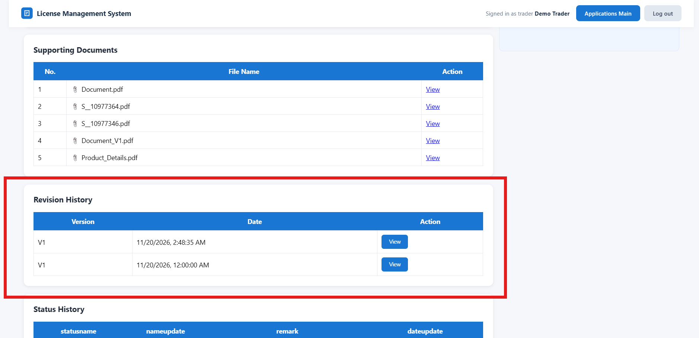

1. Open the application.
2. Open its version history.
3. Select a version to view the saved application snapshot, product details, and file metadata.
4. Use the historical file download function when a file from a previous version is needed.

Editing a Draft does not create a version snapshot. Version snapshots are documented for edits to non-Draft applications in an editable status.

## 4. Staff/Officer User Guide

### 4.1 View submitted applications
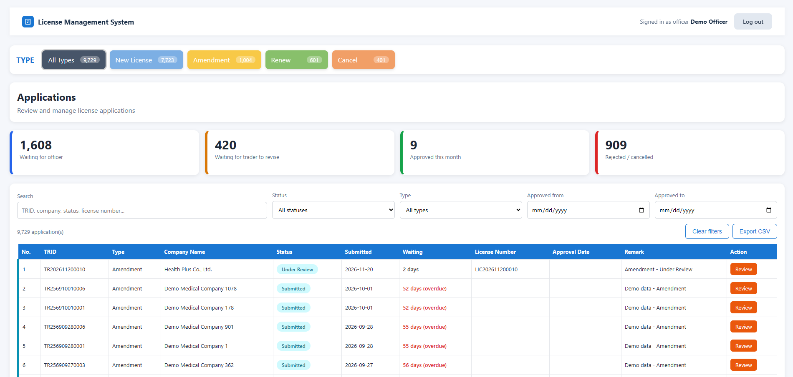

1. Log in using a Staff account.
2. Open the application list or Staff dashboard.
3. Review submitted applications and the available summary statistics.
4. Use keyword, status, type, date, sorting, or pagination features where available.
5. Open an application to inspect its details, products, status history, and file metadata.

The API limits the Staff application list to applications whose `Datesubmission` is not null.

### 4.2 Start or continue a review
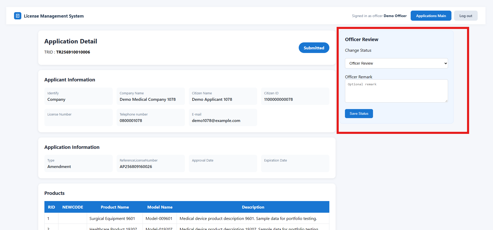

1. Open a submitted application.
2. Review the applicant and company information.
3. Review product information and supporting documents.
4. Check the application's status history and any previous remarks.
5. Use the available Staff status action to continue the review.

The documented review status is `Officer Review` (status ID 3).

### 4.3 Request corrections
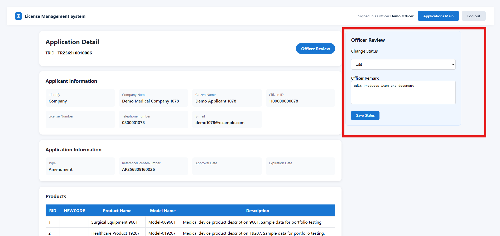

1. Open the application under review.
2. Select the revision-request action.
3. Enter a clear remark describing the corrections required.
4. Submit the status update.
5. The application moves to `Revision Required` (status ID 4).

A Staff remark is required when requesting a revision.

### 4.4 Reject an application
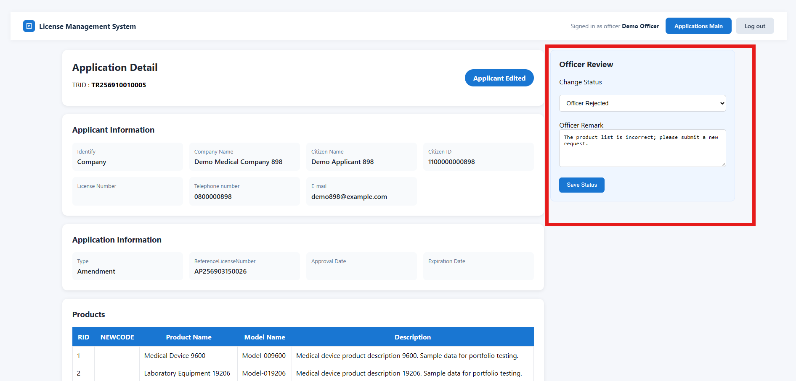

1. Open the application under review.
2. Select the reject action.
3. Enter the required remark.
4. Submit the status update.
5. The application moves to `Officer Rejected` (status ID 7).

A Staff remark is required for rejection.

### 4.5 Approve an application
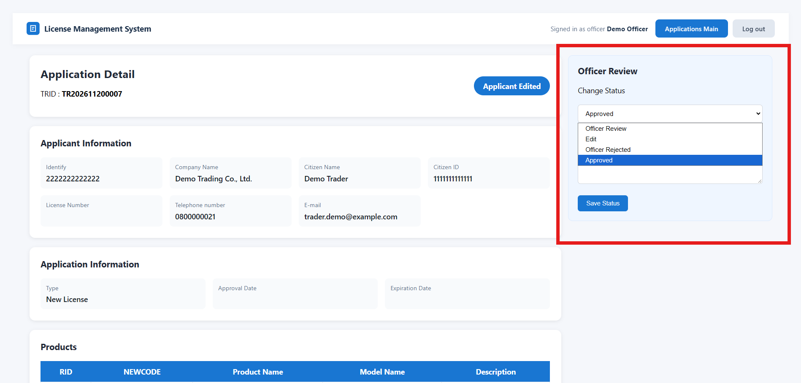

1. Open the application under review.
2. Verify the application details and supporting information.
3. Select the approve action.
4. Submit the status update.
5. The application moves to `Approved` (status ID 8).
6. The system applies the license-related result for the selected application type.

Approval outcomes:

- **New License:** generates a license number and sets a 5-year validity period.
- **Amendment:** generates a new license number and marks the previous license `Replaced`.
- **Renew:** generates a new license number and extends expiry by 5 years from the previous expiry date.
- **Cancel:** marks the original license `LicenseStatus = Cancelled`; the cancellation request itself is saved as `Approved` (status ID 8), and no new license number is generated for that request.

Approved New License, Amendment, and Renew applications receive generated product codes where applicable.

### 4.6 Generate a PDF certificate
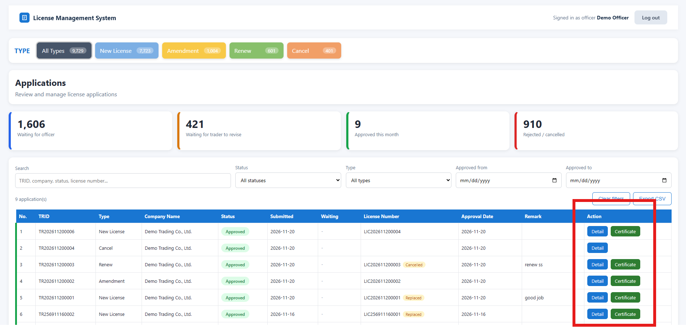
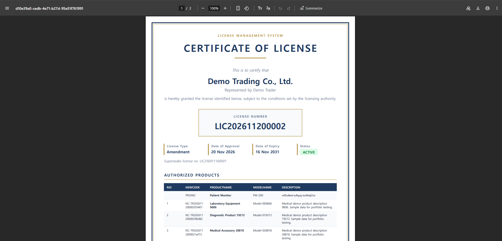

1. Open an approved application.
2. Use the certificate function for that application.
3. The API generates a PDF certificate through `CertificateBuilder`.

The documented certificate endpoint is available for approved applications.

## 5. Application Status Reference

| ID | Status | Meaning |
|---:|---|---|
| 1 | Draft | Created by the system |
| 2 | Submitted | Submitted by Applicant |
| 3 | Officer Review | Staff starts or continues review |
| 4 | Revision Required | Staff requests corrections; remark required |
| 5 | Applicant Edited | Applicant submits an edited version after revision |
| 6 | Applicant Cancel | Applicant cancels the application; remark required |
| 7 | Officer Rejected | Staff rejects the application; remark required |
| 8 | Approved | Staff approves the request |
| 9 | License Cancel | Status name exists in the controller mapping |

**Important distinction:** Status ID 6 (`Applicant Cancel`) is a Applicant cancelling an application. The `Cancel` application type is a request to cancel an existing license. When a Cancel-type request is approved, the request itself is stored as status ID 8 (`Approved`) while the original license's `LicenseStatus` becomes `Cancelled`. Although status ID 9 is defined in the status mapping, the current approval code described by the README does not assign ID 9 to the cancellation request.

## 6. Account and Session Security

- Passwords are hashed using ASP.NET Core `PasswordHasher<UserAccount>`.
- Legacy plain-text passwords are upgraded to hashes after a successful login.
- Session tokens are generated using a cryptographically secure random number generator.
- Sessions expire after 8 hours.
- Protected application API requests use the `X-Session-Token` header.
- The API checks the session, role, and application ownership on the server.
- Logging out removes the current session.
- Changing a password invalidates all sessions for the account.

Use HTTPS and do not expose session tokens in URLs or logs. The README notes that the password-change endpoint can be called without an existing session and recommends rate limiting and additional abuse protections before production use.

## 7. Troubleshooting and Notes

| Situation | What to check |
|---|---|
| Login fails | Check username/password and confirm the account exists. Confirm the API can access SQL Server. |
| Protected request is rejected | Sign in again and confirm the request includes a valid, unexpired `X-Session-Token` header. |
| Applicant cannot see an application | Confirm the application belongs to the signed-in Applicant account. Ownership is determined server-side. |
| Staff cannot see an application | Confirm the application has been submitted and `Datesubmission` is not null. |
| Submission is blocked | Confirm that at least one valid product has been added and required information is complete. |
| File upload is rejected | Check file type, 10 MB per-file limit, 10-file per-request limit, and application status. |
| File cannot be deleted | File deletion is documented only for Draft applications. |
| Renew option is unavailable | Confirm the referenced active license expires within the next 3 months and meets the API's eligibility rules. |
| Historical file is unavailable | Check the historical file metadata/path and the version-file download operation. |

## 8. Known Limitations

- The project is under active development; UI details may change.
- The README does not provide screenshots or exact field-by-field instructions for every page.
- An automated unit/integration test project is not represented in the supplied project structure.
- Uploaded files are stored under `wwwroot/uploads`; production deployment should review direct public access and consider moving files outside the web root.
- File upload and database metadata persistence are not one atomic operation; orphaned files may require cleanup.

---

**Project:** License Management System  
**Roles:** Applicant or Trader / Staff or Officer
**Status:** Under active development
